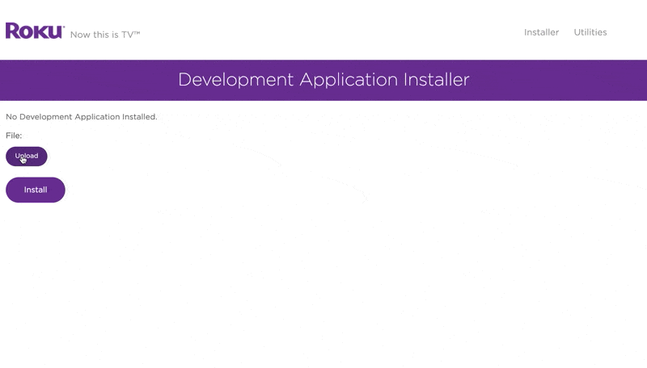

# Sideloading On Roku

Roku ended private channels, so you install put.io by sideloading a ZIP onto a
Roku in Developer Mode.

## Before You Start

- A Roku on the same local network as your computer
- A computer with a web browser
- The [published Roku ZIP](https://roku.put.io/v2.zip), or a local build (see [Contributing](../CONTRIBUTING.md#run-locally))

Do not extract the ZIP.

## 1. Enable Developer Mode

On your Roku remote, press:

`HOME`, `HOME`, `HOME`, `UP`, `UP`, `RIGHT`, `LEFT`, `RIGHT`, `LEFT`, `RIGHT`

On the Developer Settings screen:

1. Choose `Enable Developer Mode`
2. Accept the prompts
3. Set a password for the web installer
4. Note the Roku IP address shown on screen

The Roku reboots.

## 2. Open The Developer Installer

In a browser on the same network, open the Roku IP address, for example
`http://192.168.0.10`. Sign in as `rokudev` with the password from step 1.

## 3. Upload The App ZIP

1. Choose the ZIP file
2. Select `Install`
3. Wait for the success message

put.io then appears on the Roku home screen as the developer app.
